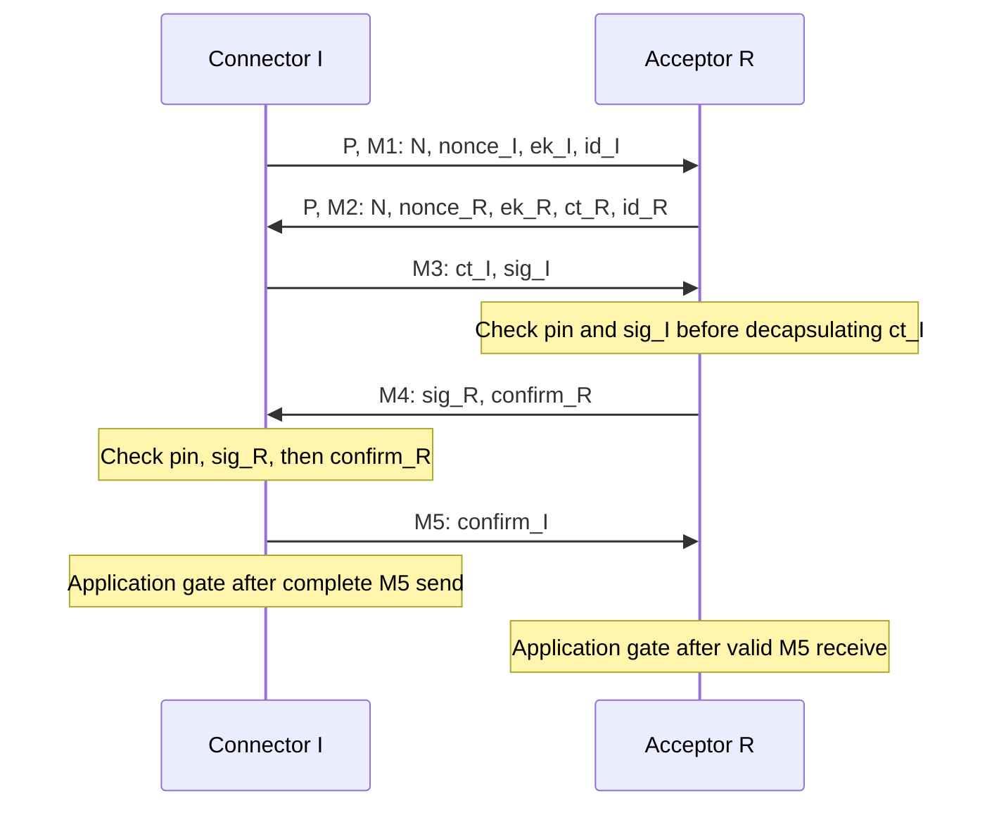

# Candidate 1: independent cryptographic review package

This is an implementation assurance handoff prepared by the implementing agent.
It is not an independent audit, formal proof, certification or deployment approval.
Review the [frozen specification](mercatura-pq-transport-v1.md) as the authority;
the formulas below are navigation aids and must be checked against it.
The [B3 report](mercatura-pq-b3-protocol-assurance.md) and
[machine evidence](mercatura-pq-b3-evidence.json) identify the qualified source,
executed checks, failures, instrumentation boundaries and CI references.

## Review identity and immutable inputs

Candidate 1, wire version 1, suite 1; five messages, two prefaces, no extensions.
B3 starts at `94bd925c95477f44ee5a427e3a7995e70e1abe20`, following qualified
B2 source `61d7009edc1950a8294ac0133349fd7e75bf2fef`.
The B3 source under review is `db84cc3ac3bcd71b7f6cf913c7eef695e407873d`.
Production protocol and cryptographic sources are byte-identical to B2; B3
adds regression/qualification coverage and this documentation.

| Review input | Location / identity |
| --- | --- |
| Canonical specification | `doc/design/mercatura-pq-transport-v1.md`; SHA256 `5960a8a1f032280f3a4bacb9aad07331eb1cae975e566e657e58d8d84ddc2e42` |
| Candidate records, transcript commitments, signatures, HKDF and confirmations | `src/test/data/pq_p2p_candidate1.json`; SHA256 `6222abf5163ee34a987fe383a8e10b07e50abf1a3ab93f2a0e031a50dd9415f5` |
| Independent packet/rekey reference | `src/test/data/pq_p2p_packets.json`; 674 packets/direction, 1,348 total; exact hash in B3 evidence |
| Primitive/ACVP inputs | `src/test/data/pq_p2p_primitives.json`, `pq_p2p_mldsa_acvp.json`; hashes in B3 evidence |
| ML-KEM-768 | mlkem-native v2.0.0, upstream `d1b2fe782888bdb761a50336012923180be7f502`; copied file manifest `mercatura-pq-dependencies.json` |
| Pure ML-DSA-65 | mldsa-native v2.0.0, upstream `834a90d5e846ffa1e1611bd24e160bb2e9b86d35`; existing `mercatura_mldsa.c` wrapper |
| Symmetric primitives | `src/crypto/{sha3,hmac_sha3_384,chacha20,chacha20poly1305}.*`; HKDF wrapper `mercatura_p2p_crypto.cpp` |

Public deterministic fixture seeds are reproducibility inputs, never node
operational identities. No wallet, datadir, RPC cookie or operational secret
belongs in the review package. Inspect Git history and frozen hashes rather
than relying on a report's claim of unchanged inputs.

## Objectives, trust and adversary

Intended goals are confidentiality against passive recording, authenticated
possession of the presented signing key, exact expected-peer binding when an
operator independently supplies a pin, session/role/network separation, explicit
mutual confirmation, replay rejection and fail-closed required-PQ selection.
These are goals under assumptions, not conclusions established by finite tests.

The adversary may observe, delay, reorder, replay, truncate and modify network
bytes, initiate bounded concurrent sessions, or act as a legitimate malicious
peer. An unpinned intermediary can terminate two valid sessions using its own
identities. A signature proves key possession; it supplies no operator-name
binding. Pin trust is directional and exact to the configured endpoint spelling.
An inbound peer does not inherit the outbound peer's verified status.
No identity grants validation, chain selection, admission or consensus privilege.

Assume secure fresh randomness, appropriate ML-KEM/ML-DSA and symmetric security,
correct implementation, uncompromised active endpoint memory and a trusted pin
channel when expected-peer assurance is claimed. Later signing-key compromise
should not disclose past sessions only if ephemeral decapsulation keys, coins,
shared secrets, PRK and copies were erased. Live memory/RNG compromise is outside
that goal; the symmetric ratchet does not provide post-compromise recovery.
Public identities, signatures, traffic sizes, timing and the preface remain
visible. Stable persistent identities are correlatable, including over Tor.
Sybil/eclipse resistance, decentralized discovery and bootstrap are separate.

## Construction to review

Integers are little endian; `D(s)=u16(len(s))||ASCII(s)`, `H=SHA3-384` (48 bytes),
`TH(x)=H(D("Mercatura/P2PTranscript/v1")||x)`, `MAC=HMAC-SHA3-384` (48 bytes).
The preface `P` is the 16 ASCII bytes `Mercatura/P2P/PQ`.
Every 12-byte header contains type, sender role, version 1, suite 1, flags zero
and the exact u32 body length. Roles are connector I=0 and acceptor R=1.



M1..M5 total record lengths are 3265/4353/4409/3369/60; complete exchange
15488 bytes, I sends 7750 and R sends 7738 including prefaces.
Network `N` is 85 bytes: chain ID, 4-byte message start, 32 raw genesis bytes,
48-byte challenge hash (SHA3 of signet challenge or empty bytes). Production
currently constructs it only for regtest and rejects enablement elsewhere.
Offline synthetic discriminator mutations do not qualify signet deployment.

R encapsulates to fresh `ek_I` to obtain `(ct_R,ss_R)`; I encapsulates to fresh
`ek_R` to obtain `(ct_I,ss_I)`. Both sides generate ephemeral keypairs and coins.
KEM is not DH; no commutativity or robust-combiner theorem is assumed.
Exact-size invalid ciphertexts retain upstream implicit rejection; confirmation
must detect mismatched secrets without exposing a ciphertext-validity oracle.

Let `A=D("Mercatura/P2P/v1")||P||M1||P||M2`. Then:

```text
h3    = TH(A || header3 || ct_I)
msg_I = D("Mercatura/P2PSignature/v1") || 00 || h3
sig_I = PureMLDSA65.Sign(sk_I, msg_I, CTX, fresh_rnd_I)
T3    = A || M3
msg_R = D("Mercatura/P2PSignature/v1") || 01 || TH(T3 || header4)
sig_R = PureMLDSA65.Sign(sk_R, msg_R, CTX, fresh_rnd_R)
T4sig = T3 || header4 || sig_R
IKM   = u16(32) || ss_R || u16(32) || ss_I
salt  = H(D("Mercatura/P2PExtract/v1") || h3)
PRK   = HMAC-SHA3-384(salt, IKM)
info(label,L,c) = D("Mercatura/P2PKeySchedule/v1") || D(label) || u16(L) || c
K(label,L,c)    = RFC5869.Expand(PRK, info(label,L,c), L)
kc_R  = K("confirm/r2i",48,h3)
kc_I  = K("confirm/i2r",48,h3)
confirm_R = MAC(kc_R, D("Mercatura/P2PConfirm/v1") || 01 || TH(T4sig))
T4 = T4sig || confirm_R
confirm_I = MAC(kc_I, D("Mercatura/P2PConfirm/v1") || 00 || TH(T4 || header5))
T5 = T4 || header5 || confirm_I
h5 = TH(T5)
```

`CTX` is exactly the 20 ASCII bytes `Mercatura/P2PAuth/v1`, no terminator.
The underlying FIPS prefix is `00 || 14 || CTX`; this is Pure ML-DSA signing a
76-byte protocol message containing a SHA3 digest. It is not HashML-DSA or an
external-mu API. The transaction context `Mercatura/PQAuth/v1` is distinct.
Headers 3/4 retain their full final body lengths in prefix commitments.

Derive five independent 32-byte outputs `K(label,32,h5)` for
`app/i2r/length`, `app/i2r/payload`, `app/r2i/length`, `app/r2i/payload`,
and `session/id`. Session ID bytes are displayed directly in lowercase hex.
No wallet HKDF labels, slicing or 32-byte confirmation truncation are permitted.

Packets use separate directional FSChaCha20 length and FSChaCha20Poly1305
payload ciphers, counters initially zero. Encrypt the u24 contents length;
AAD is `D("Mercatura/P2PPacket/v1")||h5||sender_role||wire_length`.
Payload plaintext is control (0x00 application or 0x80 discard) plus contents.
Expansion is 20 bytes. Ordinary contents cannot be empty; maximum 4000013
bytes before local application caps. No plaintext is delivered before a valid
tag. Decoys advance counters but deliver nothing. Socket fragments reuse
cached ciphertext/length state. Authentication failure permanently closes it.
Each direction rekeys every 224 packets using the existing FS classes and
reserved keystream construction in specification section 8; no PRK/KEM state
is retained for rekey. Close before packet number 2^32.

## Implementation and evidence navigation

| Boundary | Production entry points | Reviewer evidence |
| --- | --- | --- |
| Canonical records/transcripts | `Header`, `ValidHeader`, `Handshake::Start/Advance`, `Add/Transcript/SignMessage` in `net_pq_protocol.cpp` | Candidate vector; `pq_p2p_tests`; new `pq_assurance_tests` |
| KEM, Pure signatures, HKDF, comparisons | `KEMKey`, `Identity::Sign`, `Verify`, `Extract/Expand/MAC/Equal` in `mercatura_p2p_crypto.cpp` | Primitive/ACVP checker; context and all-48-byte confirmation negatives |
| Confirmation and final keys | `Handshake::Schedule/Finish/Advance` | Exact vector; live transcript alteration; interleaved sessions and foreign M3/M4/M5 |
| Ownership and asynchronous publication | `Work::Discard`, `Context::Run/Stop`, `PQTransport::Queue/Poll/Fail` | B1 ownership inventory/barriers; B3 late cancellation at all five job completions |
| Application gate and cleanup | `PQTransport::ReceivedBytes/MarkBytesSent/SetMessageToSend/GetReceivedMessage/Disconnect` | Per-record partial send, M5 byte gate, failed sibling containment, coalesced M5+packet |
| Expected identity | `ParseFingerprint/ParsePinBinding`, `MakePQTransport`, `Handshake::CheckPeer` | Exact IPv4/IPv6/name/port factory bindings; positive/wrong-pin/rotation functional tests |
| Packet authentication/rekey | `PacketCipher`, underlying FS classes, adapter buffering | Frozen 1348 packets; B3 directional boundaries, stale state, replay, tag and call-order errors |
| Network and downgrade policy | `RegtestNetwork`, `AppInitParameterInteraction`, PQ context setup, `MakeTransport`, `ShouldReconnectV1` | All 85 discriminator bytes; public-network startup rejection; required-mode functional negatives |
| Public assurance | `PQTransport::GetInfo`, `CNode::CopyStats`, `getpeerinfo` | Pending/failed false flags, unpinned versus pinned, fresh reconnect and peer removal |

One Context owns two crypto workers, at most 32 queued jobs, 64 pending leases,
4 per known source, and 16 anonymous pending endpoints. B2 documents rate,
deadline and accounting details. Identity/pins do not bypass limits.
Secrets move with exclusive handshake/work ownership; B1 inventories wipes and
their limits. Application buffers do not promise secure plaintext erasure.

## Questions requiring independent judgment

1. Does the two-contribution ML-KEM construction meet its intended properties
   under realistic active/malicious-peer assumptions? State the required
   adversary model and any combiner argument.
2. Do exact signature/KDF/MAC inputs and canonical encodings bind every relevant
   identity, network, nonce, KEM field, earlier signature and record position?
3. What mutual authenticated-key-exchange properties does this construction
   actually provide, and under which compromise/acceptance model?
4. Are M4/M5 confirmation and the local gate events sufficient for the exposed
   assurance states, including initiator send completion versus responder receipt?
5. Are role and concurrent-session separation sound, including exclusive worker
   ownership and generation checks beyond the enumerated interleavings?
6. Is reflection or unknown-key-share ambiguity possible under the stated
   identity/trust model despite the finite substitution regressions?
7. Are unpinned key possession, external expected-peer pins, exact destination
   aliases, rotation and required-mode downgrade policy correctly specified?
8. Are forward-secrecy claims limited appropriately to later identity compromise
   and realistic erasure? Distinguish endpoint compromise, KCI and recovery.
9. Do directional keys, exact AAD, encrypted lengths, packet limits and rekey
   rules preserve the required confidentiality and authentication properties?
10. Which properties need formal analysis, a theorem, independent implementation
    or additional adversarial analysis before deployment? Include native timing,
    implicit rejection, MAC comparison and error/oracle behavior in that review.

No symbolic tool or formal proof is claimed. Modeling KEM implicit rejection,
malicious contributions, erasure and asynchronous acceptance soundly needs
reviewer choices; replacing them with unexamined ideal functions would overstate
what a model establishes. The event diagram, exact formulas, tests and source
map are inputs for that review.

## Outstanding deployment gates

Independent cryptographic review remains mandatory. Windows persistent identity
storage is unsupported and fails closed; POSIX unencrypted storage assumes
trusted user/filesystem/ancestors and lacks power-loss/hostile-user assurance.
Qt peer presentation, discovery, decentralized bootstrap, external independent
peer interoperability, real IPv6/NAT/Tor/proxy behavior, representative hardware,
broader platform release qualification and authorized public-testnet operation
remain separate work. B2's GUI heartbeat and latency/sampling limitations remain.
B3 does not authorize public PQ listeners, mainnet enforcement, new consensus
rules or any activation change.
