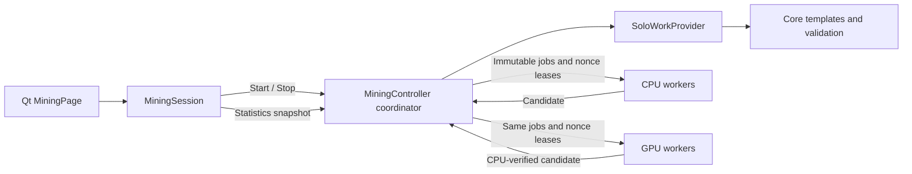

# MercaHash V2 rebuild: V1 baseline checkpoint

This is a partial Milestone A checkpoint, not a completed V2 rebuild. Development
is blocked at the required physical-GPU baseline gate. No V2 hashing, activation,
GPU, scheduling, or networking changes have been made.

## Source and isolation

- Official remote: https://github.com/Mercatura-Core/Mercatura-Core
- Historical parent: `724428dbe551fb6bfb8c81272ef74647ebbba839`
  (`mining: clear handled CUDA allocation errors before hashing`).
- New branch: `feature/mercahash-v2-rebuild`.
- Isolated source: `/workspace/mercatura-v2-rebuild`.
- Isolated build: `/workspace/mercatura-v2-rebuild-build`.
- The original checkout at `/workspace/Mercatura-Core` remains on `work`, with
  its original HEAD `631886dd5159614b628ced3fe4fa1e289ce19451` and clean files.
- The branch was created exactly at the historical parent and its worktree was
  verified clean before configuring or building. No original branch was reset,
  cleaned, merged, or pushed.
- G1 `128ea7e091da4f5ec9d2c71cdc0d4257b981b07c` was fetched as reference only;
  it descends from the baseline. Its V2 specification and vector file are
  available in the object database. No G1 implementation was merged or copied.
- The user's original WSL worktrees, wallet data, existing CUDA artifacts, and
  two uncommitted G1 linker fixes are not attached to this cloud environment.
  They have not been accessed or changed.

Workspace paths replace the preferred home-directory paths because this is an
attached cloud workspace, not the specified Windows/WSL development machine.
All dependencies were unpacked into `/workspace/work/prefix`; system packages,
system headers, CUDA headers, and user home directories were not modified.

## Environment and build

Debian 13 x86-64, GCC 14.2, CMake 3.31.6, Ninja 1.12.1, Qt 6.8.2. The container
has a two-core CPU quota and an 8 GiB memory limit. There are no exposed NVIDIA
or DRM device nodes, NVIDIA management tools, or CUDA compiler. The actual
production worker budget permits the measured worker counts only.

The baseline uses an out-of-tree Qt/wallet/test build with OpenCL enabled and
CUDA disabled. C++ optimization is `-O2`, with debug symbols disabled (`-g0`)
to limit build resource use. Build concurrency is the requested `-j4`.

```sh
. /workspace/work/build-env.sh
cmake -S /workspace/mercatura-v2-rebuild \
  -B /workspace/mercatura-v2-rebuild-build -G Ninja \
  -DCMAKE_BUILD_TYPE=RelWithDebInfo \
  -DCMAKE_CXX_FLAGS_RELWITHDEBINFO='-O2 -g0' \
  -DENABLE_IPC=OFF -DBUILD_GUI=ON -DBUILD_TESTS=ON \
  -DWITH_CUDA_MINING=OFF -DWITH_OPENCL_MINING=ON
cmake --build /workspace/mercatura-v2-rebuild-build -j4
```

## Validation results

The unchanged baseline built all configured Qt/OpenCL/test targets. Compilation
took about 21 minutes across the initial attempt and an incremental resume. The
first attempt could not find the prefix's Libevent headers in the CLI target;
adding the workspace include directory through `CPLUS_INCLUDE_PATH` resolved it
without editing project code. Original source and tests were clean when the
baseline validation ran.

| Check | Result |
| --- | --- |
| Unchanged V1 permanent vectors | Passed, 1.17 s |
| Focused PoW/mining/wallet/resource/statistics/device-arithmetic unit selection | 94 cases passed, 75.48 s |
| Original Qt mining suite | 14 reported passes, no failures/skips, 15.74 s |
| Native functional selection, `--jobs=4` | 6/6 passed, 186.70 s including cache preparation |
| Added live Qt regression plus original Qt suite | 16 reported passes, no failures, one resource skip, 32.70 s |
| GPU discovery | Exit 77; CUDA not compiled, no AMD OpenCL GPU detected |
| Include/file lint and diff whitespace | Passed |

Qt's reported totals include initialization and cleanup. The final additional
worker rows are one-worker and two-worker passes; the six-worker row is skipped
because the production detector reports maximum 2. This is not six-worker
qualification. Device-arithmetic and simulated-backend unit passes are not
physical GPU results. CUDA host/device compilation was not performed.

The focused unit selection comprises `pow_tests`, `cpu_miner_tests`,
`gpu_miner_tests`, `worker_limits_tests`, `mining_statistics_tests`,
`mercahash_gpu_tests`, `mercahash_gpu_sync_tests`, `cuda_binding_tests`,
`mining_tests_wallet`, and `mining_tests_solo`. The V1 vector case ran separately.

The native scripts are `mercatura_mining.py`, `mercatura_mercahash_pow.py`,
`mercatura_chain_reorg.py`, `mercatura_coinbase_template.py`,
`mercatura_solo_native.py`, and `mercatura_network_identity.py`. Native Solo
qualification produces 102 production-controller blocks, spends a matured PQ
reward, and imports the blocks into a separate normal regtest node, verifying
normal acceptance and reward/fee accounting. All chains/wallets are fresh test
fixtures. No public mining or production wallet was used.

### Bounded real-hash controller measurements

These are three five-second cycles per worker count with synthetic public jobs,
not a wallet/UI or live-submission measurement. Rates divide total completed
hashes by total elapsed time, including shutdown.

| Workers | H/s | Worst Stop request | Worst worker shutdown | Peak RSS |
| --- | --- | --- | --- | --- |
| 1 | 7.41 | 0.019 ms | 100.21 ms | 130.1 MiB |
| 2 | 13.47 | 0.018 ms | 105.41 ms | 258.1 MiB |

Every cycle ended with zero active workers. These short runs do not establish
long-duration memory stability or target-machine performance.

### Live Qt Solo measurements

The new test runs real MercaHash V1, SoloWorkProvider, template creation,
consensus submission, wallet notifications, and MiningPage on Qt's offscreen
platform. It uses no hash/provider test double. Each supported count completes
three Start/Stop cycles and then a separate active-mining session shutdown.

| Workers | Accepted blocks across three cycles | Hashes | Max queued Stop dispatch delay | Max Stop handler duration | Max observed Stop completion | Max displayed-statistics gap | Session shutdown | Max heartbeat gap incl. shutdown |
| --- | --- | --- | --- | --- | --- | --- | --- | --- |
| 1 | 15 | 33 | 2 ms | 0 ms | 152 ms | 507 ms | 103 ms | 115 ms |
| 2 | 20 | 53 | 1 ms | 1 ms | 102 ms | 517 ms | 119 ms | 130 ms |

Stop is a programmed Qt timer followed by the actual MiningPage button click;
dispatch delay measures event-loop delay beyond its scheduled deadline, not
physical mouse/window-system input latency. Times use a monotonic clock with
millisecond resolution (0 ms means less than one tick). Observed Stop completion
includes the test's polling delay; it is an upper observation, not an exact join
timestamp. Display publication requires both an advancing completed-hash counter
and changed visible statistics text. Heartbeat includes the synchronous session
shutdown barrier. These are V1 results only.

The regression asserts sub-second dispatch, handler, shutdown and event-loop
responses, advancing statistics within 1.5 seconds, accepted blocks, zero rejected
submissions, zero workers after Stop, and no accepted-block increment after
stopping. It does not target Stop at a deterministic point inside template
creation/submission. It does not simulate the full application's normal Close
and restart. Those gates, V2 easy-regtest stress, and combined harder-work
qualification remain pending.

Run the added test on a suitably provisioned host with an external watchdog:

```sh
QT_QPA_PLATFORM=offscreen timeout -k 5s 300 \
  /workspace/mercatura-v2-rebuild-build/bin/test_mining-qt liveSoloResponsiveness
```

## Exact changed files

- `src/qt/test/miningtests.cpp`: permanent live V1 Solo responsiveness rows for
  1, 2 and 6 workers, with actual-resource skips, timing counters and assertions.
  This establishes a reusable integration regression before V2 mining changes.
- `doc/mining/MERCAHASH-V2-REBUILD-BASELINE.md`: this measured checkpoint,
  source isolation, observed lifecycle, unverified gates and release status.

No production `.cpp`/`.h`, CMake build logic, miner workload, network parameters,
wallet data, or GPU source is changed. The patch contains no generated binaries,
blockchain data, wallet keys, runtime logs, or dependency packages.


## Architecture observed at the baseline

This diagram describes the V1 source paths; hardware GPU execution is unverified.



`MiningPage` dispatches Start/Stop to the shared `MiningSession`. A background
coordinator in `MiningController` prepares the wallet payout destination and
owns `SoloWorkProvider`. The provider creates native block templates and submits
solutions through the in-process mining interface and normal block validation.

CPU workers retain private `PoWHashContext` objects. GPU workers retain a backend
and an independent CPU candidate verifier. Both consume immutable shared jobs
and disjoint atomic nonce leases. A job's solved/cancelled/valid flags prevent
obsolete candidates from reaching submission; accepted blocks retire the job.

Stop sets the controller's atomic stop flag, cancels the current job, notifies
waiting workers, and interrupts the provider. The coordinator joins workers and
then releases the provider. `MiningSession::shutdown()` is a lifecycle barrier
that waits for the coordinator. WalletController defers destruction of a mining
wallet model until that session is finished.

The controller's statistics mutex protects short snapshots; it is released
before template creation and block submission. Provider lifetime uses a separate
mutex. `RequestStop` releases the statistics mutex before taking the provider
mutex. Native mining interruption takes the node's tip-notification mutex.
These observations identify the lock boundaries to instrument; they do not prove
that the reported G1 GUI stall has been diagnosed or fixed.

## Consensus, activation, and release status

Production mining and consensus sources are byte-for-byte unchanged from the
V1 parent. V1 retains its 128 MiB scratchpad, original geometry, domains,
permanent vectors, block identity, genesis fixtures, DGWv3, and target spacing.
No production activation schedule or genesis fixture was changed.

V2 hashing, positive-height activation, wrong-version rejection, version-aware
validation caches, transition/reorganization coverage, V2 worker resources,
and V2 device execution are **not implemented in this checkpoint**. The future
production activation height X remains unselected; no rollout date is approved.
A future implementation must explicitly distinguish an unset activation from
height zero, derive candidate height from trusted ancestry, keep production
networks on V1 until approval, and confine CLI test schedules to regtest.

No post-quantum transport work was performed. A future coordinated release must
keep MercaHash height activation, P2P transport capability/enforcement, and
existing ML-DSA-65 transaction authorization independent. ML-KEM/ML-DSA handshake
specification, negotiation, downgrade resistance, DoS controls, and activation
policy require their separate security review. Shipping both features together
does not authorize enabling either upgrade on production networks.

## Remaining acceptance gates

The assignment requires V1 NVIDIA-only and combined CPU/GPU hardware baselines
before mining changes, and says not to proceed with an uncharacterized baseline.
Those gates cannot be established here. CUDA installation or a fake-runtime
pass would not provide the missing hardware evidence.

Pending: target-machine V1 CUDA/GPU/combined results; six-worker live Qt results;
normal application Close/restart while mining; all V2 implementation milestones;
V1/V2 physical device parity; >256 V2 context allocation; easy and controlled
harder-work combined mining; all activation/reorg/wrong-version gates; Windows
and macOS build/CI results; final full regression and reliability qualification.

This checkpoint is not ready for a coordinated public-testnet upgrade. No fix
for the reported V2 CPU/combined-mode regression, no V2 hashrate, and no V2 Qt
launch command can be claimed. Cloud V1 timing is not comparable to the user's
Ryzen/RTX 3050 measurements or the G1 performance reference.

To resume the ordered milestones, attach the CUDA-capable target environment,
complete the missing V1 baseline measurements in isolated regtest directories,
and retain the local branch's exact historical parent. No permission to push,
merge, publish, or activate production consensus is implied.
